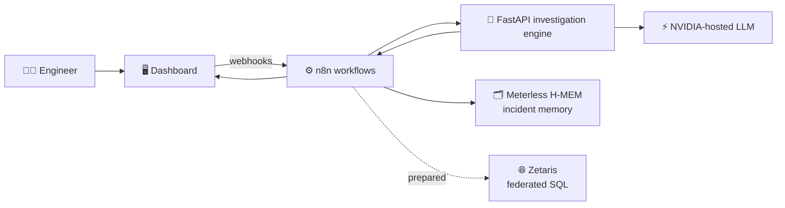
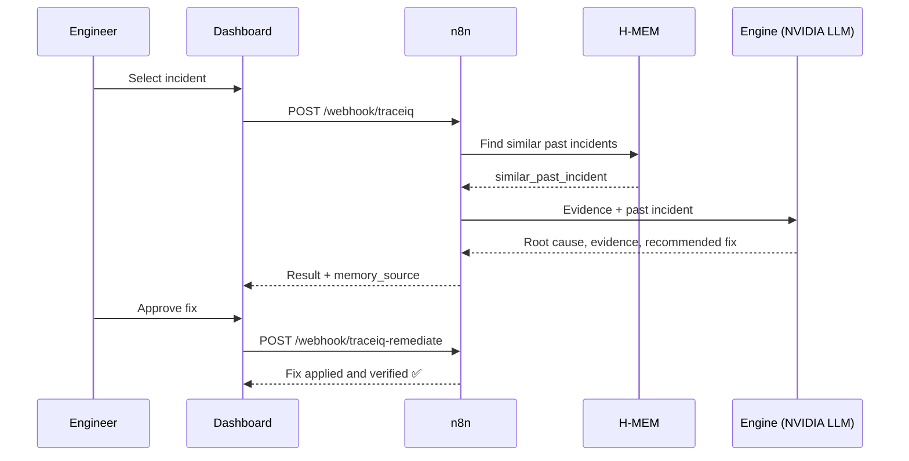

<div align="center">

# 🔍 TraceIQ

### The Agent That Can Explain *Why*

**An AI incident-investigation agent that finds the root cause, shows its evidence, and fixes only with human approval.**


### [🎥 Watch the demo]([PASTE VIDEO LINK]) &nbsp;|&nbsp; [🚀 Quick start](#-quick-start) &nbsp;|&nbsp; [🏗 Architecture](#-architecture) &nbsp;|&nbsp; [🤝 Sponsors](#-sponsor-technologies)

</div>

---

## 📌 At a glance

| | |
|---|---|
| **What it is** | An AI agent that investigates software incidents end to end |
| **Who it's for** | Software engineers and SREs |
| **Core promise** | Every answer comes with the **evidence** behind it |
| **Safety model** | A human approves every fix before anything runs |
| **Built** | After hackathon registration, entirely in Cursor |
| **Team** | [YOUR FULL NAME], Samrudhhi Sambhaji Harel, Arya Baban Jadhav |

---

## 😩 The problem

When production breaks, engineers lose hours jumping between logs, metrics and old tickets to answer one question: **why did this happen?**
The same failures keep coming back, and the knowledge of how they were fixed last time lives in someone's head.

## 💡 Our solution

TraceIQ behaves like a senior SRE who never forgets an incident:

| Step | What happens |
|:---:|---|
| 1️⃣ | **Pick** an incident on the dashboard |
| 2️⃣ | **Investigate**: the agent reads the logs and related evidence |
| 3️⃣ | **Remember**: it asks Meterless H-MEM for similar past incidents and what fixed them |
| 4️⃣ | **Explain**: it returns the root cause, the supporting evidence and a recommended fix |
| 5️⃣ | **Approve**: a human approves or rejects the fix (the agent never acts alone) |
| 6️⃣ | **Remediate and verify**: the fix runs and the agent confirms the incident is resolved |

---

## 🎬 Demo

> 📺 **Full walkthrough (2 min):** [PASTE VIDEO LINK]

| Dashboard | Root cause and evidence | Approve and verify |
|:---:|:---:|:---:|
|  |  |  |

*(Add your screenshots to `docs/screenshots/` using these names, or edit the paths.)*

---

## 🏗 Architecture



### 🔄 One investigation, step by step



**Design rules**
- The dashboard talks **only** to n8n.
- n8n orchestrates every step, so workflows are easy to inspect and change.
- If H-MEM is unreachable, the agent falls back to local memory, and the response states which source was used.
- If the engine is offline, the dashboard runs in **offline demo mode** with the sample incidents.

---

## 🤝 Sponsor technologies

| Sponsor | Role in TraceIQ | Status |
|---|---|:---:|
| 🧠 **Meterless** | The **H-MEM engine** is our incident memory. It stores past incidents and returns similar ones with their root cause and fix, so the agent builds on earlier investigations. | ✅ Live |
| ⚡ **NVIDIA** | An NVIDIA-hosted model, called through its API, powers the root-cause reasoning in the investigation engine. Model: `[MODEL NAME]` | ✅ Live |
| 💻 **Cursor** | Every part of the project (workflows, engine, dashboard, docs) was built in Cursor. Proof screenshots are in [`/proof`](./proof). | ✅ Used |
| 🌐 **Zetaris** | A federated SQL query and client are **prepared** to join incidents, logs and telemetry in place, with no heavy ETL. The Zetaris engine runs locally, but it is **not yet wired into the live pipeline**. The live demo reads sample JSON data. | 🟡 Prepared |

> We label Zetaris as *prepared* on purpose. We would rather show an honest status than a fake integration.

---

## ✨ Key features

- 🔎 **Evidence-backed answers**: every root cause comes with the logs that support it
- 🧠 **Incident memory**: similar past incidents surface automatically (`similar_past_incident`)
- 🏷 **Transparent memory source**: each response says `meterless-hmem` or `local-memory`
- 🤝 **Human in the loop**: approval is required before any remediation
- ✅ **Verification**: the agent checks the incident is resolved after the fix
- 🛟 **Offline demo mode**: the demo never breaks if a service is down
- 🐳 **One-command setup**: the whole stack runs in Docker

---

## 🧰 Tech stack

| Layer | Technology |
|---|---|
| Orchestration | n8n |
| Investigation engine | Python, FastAPI |
| LLM | NVIDIA-hosted model via API |
| Incident memory | Meterless H-MEM |
| Federated data (prepared) | Zetaris |
| Dashboard | [FRAMEWORK] |
| Infrastructure | Docker, Docker Compose |
| Development | Cursor |

---

## 🚀 Quick start

**Requirements:** Docker Desktop, Git, an NVIDIA API key and a Meterless key.

```bash
# 1. Clone
git clone [REPO URL]
cd [REPO NAME]

# 2. Configure (add your own keys)
cp .env.example .env

# 3. Start everything
docker compose up -d
```

Then open:

| Service | URL |
|---|---|
| n8n | http://localhost:5678 |
| Dashboard | [DASHBOARD URL AND PORT] |

Import the workflows from [`/workflows`](./workflows) into n8n if they are not loaded automatically.

<details>
<summary><b>🔐 Environment variables</b> (click to expand)</summary>

Set these in `.env`. **Never commit this file.**

| Variable | Purpose |
|---|---|
| `NVIDIA_API_KEY` | NVIDIA model access |
| `[MODEL VARIABLE]` | NVIDIA model name |
| `[METERLESS KEY VARIABLE]` | Meterless H-MEM access |
| `[METERLESS ENDPOINT VARIABLE]` | Meterless endpoint |

</details>

<details>
<summary><b>🔌 API reference</b> (click to expand)</summary>

n8n runs on port `5678`.

| Method | Path | Purpose |
|---|---|---|
| `POST` | `/webhook/traceiq` | Start an investigation |
| `POST` | `/webhook/traceiq-remediate` | Approve and run a fix |
| `GET` | `/webhook/traceiq-health` | Health check |

Response fields include `similar_past_incident` (`id`, `root_cause`, `fix`) and `memory_source` (`meterless-hmem` or `local-memory`).

</details>

---

## 🕹 How to use it

1. Open the dashboard.
2. Select a sample incident (**INC-001** to **INC-004**).
3. Click **Investigate** and read the root cause, evidence and recommended fix.
4. Click **Approve** to run the simulated fix.
5. Check the verification result.

---

## 📁 Project structure

*(Adjust to match your repo.)*

```
.
├── investigation-engine/   # FastAPI service: analysis with the NVIDIA model
├── workflows/              # Exported n8n workflows
├── dashboard/              # Web UI
├── zetaris/                # Prepared federated query and client
├── proof/                  # Cursor and Zetaris proof screenshots
├── docs/screenshots/       # README images
├── docker-compose.yml
├── .env.example            # Variable names only, no real keys
└── README.md
```

---

## 🧭 Honest status

| Area | Status |
|---|---|
| Investigate, recommend, approve, remediate, verify | ✅ Working end to end |
| Meterless H-MEM incident memory | ✅ Working |
| NVIDIA-powered root-cause reasoning | ✅ Working |
| Remediation | 🟡 Simulated for the demo |
| Zetaris live integration | 🟡 Prepared, not yet wired in |

## 🔮 Future enhancements

- 🌐 Make **Zetaris** the live data layer: one federated query joining incidents, logs and telemetry in place
- 🛠 Real remediation actions behind the same human-approval gate
- 📡 Ingest live logs and alerts instead of sample incidents
- 📈 Grow incident memory so every resolved incident makes the next one faster

## 📜 Pre-existing components

**None.** TraceIQ was built after hackathon registration. It uses open-source tools (n8n, FastAPI, Docker) and the sponsor services listed above.

## 🔒 Security

No API keys or secrets are committed. All credentials load from `.env`, which is listed in `.gitignore`.

---

## 👥 Team

| Name | Role |
|---|---|
| **[YOUR FULL NAME]** | [YOUR ROLE] |
| **Samrudhhi Sambhaji Harel** | [ROLE] |
| **Arya Baban Jadhav** | [ROLE] |

<div align="center">

**Built for the Open Agent Hackathon 2026 by GenAI.works** 🚀
*Sponsors: Zetaris · NVIDIA · Meterless · Cursor*

</div>
